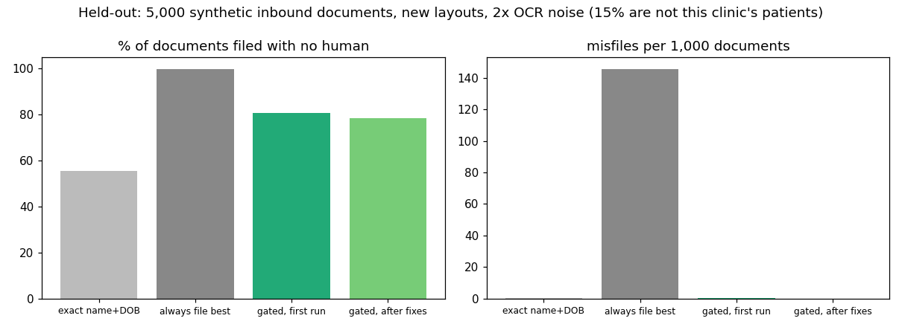

# Safe auto-filing of inbound clinical documents (Australian GP)

> Unofficial prototype by Kushagra Pratap Singh. Not affiliated with Care GP.
> Every patient, document and identifier here is synthetic (generated, checksum-valid). There is no real patient data.

## The problem
Care GP's Samantha promises to "file every inbound email, fax and scan with zero errors or manual handling" ([caregp.com.au](https://www.caregp.com.au/)). In a GP inbox the hard part isn't reading the document. It's **being sure whose it is.**
- **Families share one Medicare card and address.** Only the IRN (the person's number on the card) separates them, and it's often missing or unreadable.
- **Twins share a date of birth.** Fathers and sons can share a name. Common surnames repeat.
- **Faxes and scans add OCR errors:** O/0, l/1, S/5.
- **Some documents are about people who aren't patients of this clinic,** but share a name with one who is.

A confident wrong match puts a result in the wrong person's chart. That's a clinical-safety and privacy incident, and it's the error a "no manual handling" promise has to rule out.

## What I built
`docfile/` (stdlib):
- **`ids.py`** validates Australian identifiers:
  - Medicare number check digit (weights 1,3,7,9,1,3,7,9 mod 10; first digit 2–6), plus the IRN;
  - IHI (16 digits, 800360 prefix, Luhn).
  OCR look-alikes are mapped to digits only next to other digits.
- **`clinic.py`** builds a synthetic patient index with households on shared cards, twins, sons named after fathers, married-name changes and common surnames.
- **`docs.py`** generates inbound documents: pathology, radiology, specialist letters, discharge summaries, and (held-out) pipe-separated lab results, emails and fax cover sheets. Names appear in many forms ("NGUYEN, J.", nicknames, previous surnames), dates in several formats, with OCR noise, and 10–15% are for people who aren't patients here. Some results are critical.
- **`match.py`:**
  - finds candidates from names, dates and identifiers **anywhere** in the text (labels get mangled by OCR);
  - scores every field (Fellegi–Sunter style weights; a valid Medicare match plus IRN is strong evidence, an IHI match is decisive);
  - names after "Dr" are ignored, since they belong to the clinician.

  **AUTO_FILE only if** the best score is ≥ 9, beats the runner-up by ≥ 4, no identifier conflicts (IRN or IHI pointing at someone else), and the name and DOB agree with the identifiers. Otherwise REVIEW with the reason. Critical results are flagged **URGENT to GP** either way.
- **Baselines:** exact first + last name + DOB; and "file to the best match, always".

## Results: held-out
5,000 documents in 5 clinics, with layouts never run during development, twice the OCR noise, more nicknames and initials, IRN missing half the time, US-style and dotted dates, 15% non-patients, and new critical-result wording. The config was frozen in git before the first run (`heldout/config.json`, commit a0a7189).

| | Filed with no human | Misfiles per 1,000 | Urgent results flagged |
|---|---|---|---|
| exact name + DOB | 55.4% | 0.2 | 62/95 |
| always file the best match | 99.6% | 145.6 | 62/95 |
| **gated, first run** | **80.6%** | **0.2** (1 document) | **62/95** |
| gated, after the two disclosed changes | 78.3% | 0.0 | 95/95 |

About 85% of these documents belong to a patient of the clinic, so 85% is the most that could be filed automatically.



**What went wrong, and what changed after the first run**
1. **One misfile.** A letter opened "Dear Dr Patel, Re: Olivia Chen, DOB 06/04/1951". The clinic has an Olivia **Patel** born that day, and the doctor's surname counted as the patient's. Fix: names after "Dr/Doctor/Prof" are ignored.
2. **Urgent recall 62/95.** New wording ("H\*", "Please action today") wasn't recognised. Fix: added.
3. **Found while building the demo, not by the held-out run:** a fax with **Jack**'s name but **Liam**'s IRN (twins on one card) auto-filed to Liam, because the identifiers won. Fix: when the name or DOB on the page disagrees with the identifiers, it goes to REVIEW. This costs about 2 points of auto-filing; most of those reviews are OCR-mangled names.

**The after-fix row is no longer held-out.** The first-run row is the honest number for documents it hadn't seen.

**Limits**
- Synthetic documents are cleaner than real faxes: no handwriting, no multi-patient documents, no cover pages without identifiers.
- Weights and thresholds were set by hand on dev. In production they should be fitted on a clinic's own filing history, and the auto-file threshold set from a measured misfile rate.
- No integration with Best Practice or MedicalDirector.

## Run it
```
python demo.py                  # twins on one card, a conflicting IRN, a letter about a non-patient
python evaluate.py heldout      # the table above
python -m unittest discover tests
```
Python 3.10+, no dependencies (matplotlib only for `docs/plot.py`).
